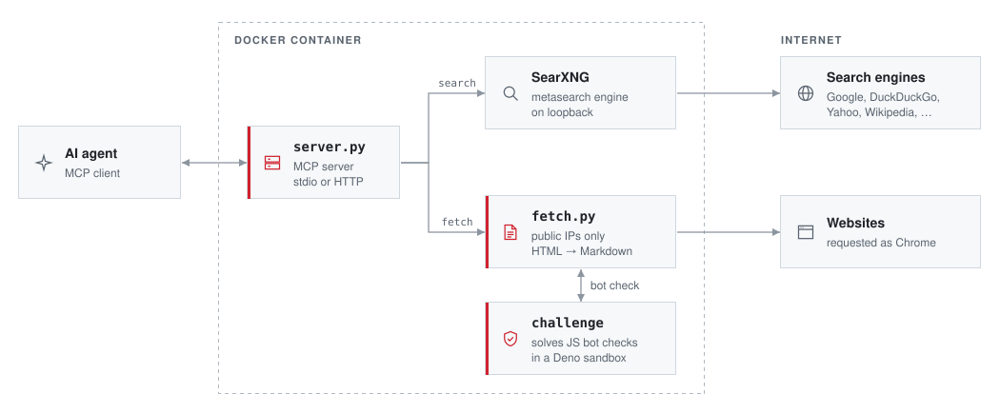

<p align="center"></p>

An MCP server for web search and page fetching, in a single Docker container. No configuration, no
API keys.

A nice improvement for example is full access to reddit posts and comments.



## Setup

Pull the image first (so the client doesn't time out on the first start while it downloads):

```sh
docker pull ghcr.io/belluxx/sharp-search-mcp
```

For Cursor and VS Code, in one click:

[](https://cursor.com/install-mcp?name=sharp-search&config=eyJjb21tYW5kIjoiZG9ja2VyIiwiYXJncyI6WyJydW4iLCItaSIsIi0tcm0iLCJnaGNyLmlvL2JlbGx1eHgvc2hhcnAtc2VhcmNoLW1jcCJdfQ==)
[](https://insiders.vscode.dev/redirect/mcp/install?name=sharp-search&config=%7B%22command%22%3A%22docker%22%2C%22args%22%3A%5B%22run%22%2C%22-i%22%2C%22--rm%22%2C%22ghcr.io%2Fbelluxx%2Fsharp-search-mcp%22%5D%7D)

Claude Code:

```sh
claude mcp add -s user sharp-search -- docker run -i --rm ghcr.io/belluxx/sharp-search-mcp
```

Codex:

```sh
codex mcp add sharp-search -- docker run -i --rm ghcr.io/belluxx/sharp-search-mcp
```

## Security stuff

- fetch only connects to public IPs, including after redirects, so it can't reach localhost or your
  LAN.
- Bot-check scripts run in [happy-dom](https://github.com/capricorn86/happy-dom), inside a Deno
  sandbox with no file, process or network access + a time and memory limit.

For extra hardening:

```sh
docker run -i --rm --read-only --tmpfs /tmp --cap-drop ALL --security-opt no-new-privileges --memory 512m ghcr.io/belluxx/sharp-search-mcp
```
